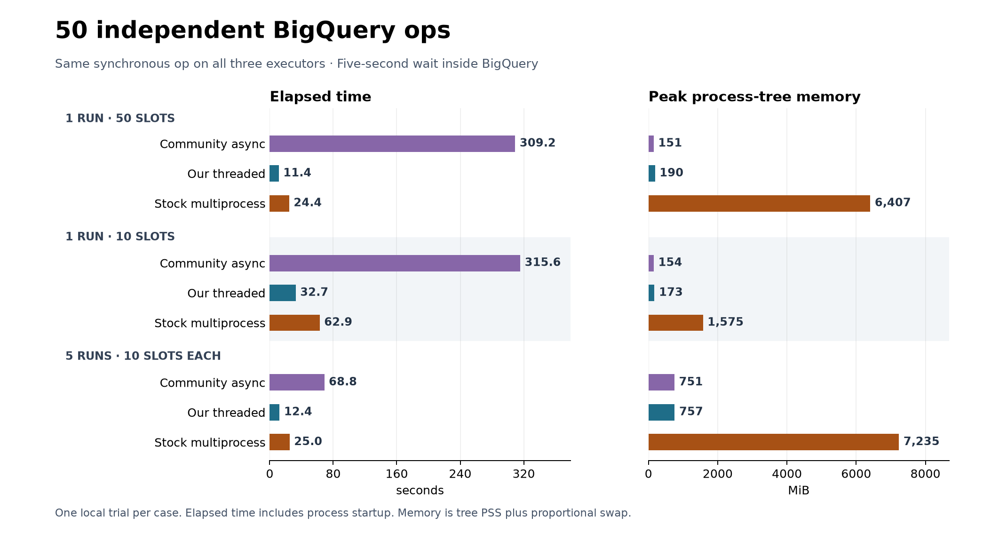

# Dagster threaded executor

Run independent steps on threads in one run worker. Supports stock Dagster **1.13.31** and Python **3.11–3.14**. The Dagster pin protects against changes to its private execution APIs.

## Install

```sh
python -m pip install https://github.com/gajop/dagster-threaded-executor/releases/download/v0.1.0/dagster_threaded_executor-0.1.0-py3-none-any.whl
```

Install wherever Dagster imports your definitions or executes runs. Set the executor once per code location. Jobs with an explicit executor keep it.

```python
from dagster_threaded_executor import threaded_executor

defs = dg.Definitions(jobs=[my_job], executor=threaded_executor)
```

Set the per-run thread limit in [run YAML](examples/run.yaml).

```yaml
execution:
  config:
    max_concurrent: 2
```

Shared resources and I/O managers must be thread-safe. Cancellation waits for running steps to exit.

For a fixed limit, pass `threaded_executor.configured({"max_concurrent": 2}, name="threaded_default")` to `Definitions`.

## Run the example

From a checkout, run [two independent synchronous ops](examples/definitions.py).

```sh
dagster job execute -f examples/definitions.py -a defs -j two_waits -c examples/run.yaml
```

## BigQuery benchmark



Each case ran 50 identical sync ops on local Linux with Python 3.13. Each op submits [one five-second server-side wait](benchmark/wait.sql) and polls job status. The queries scanned and billed zero bytes. Wall time includes startup. Peak memory sums process-tree PSS and proportional swap. The three async cases ran concurrently. [Measured results](benchmark/results.csv)

From a checkout, configure Google Application Default Credentials with a BigQuery project, then run:

```sh
python -m pip install '.[benchmark]'
python benchmark/profile.py
python benchmark/compare.py
```

The full run takes about 15 minutes. Results and the regenerated chart go in `benchmark/runs/`.
